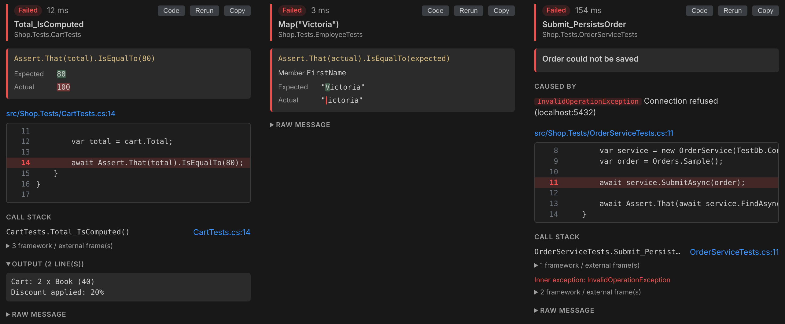
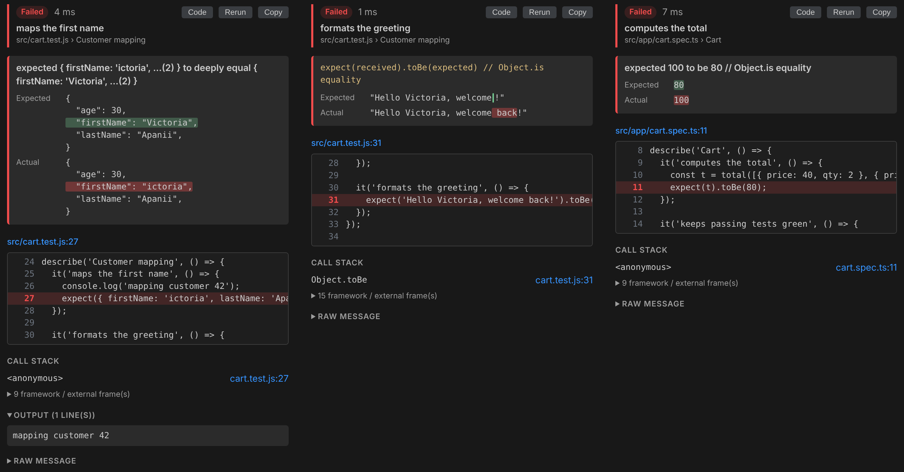

# Readable Tests

**Des résultats de tests lisibles dans VS Code, pour .NET et JavaScript** — TUnit / Microsoft.Testing.Platform, xUnit, NUnit, MSTest, **Vitest, Jest et Angular CLI**.

L'explorateur de tests vous dit *qu'un* test a échoué. Readable Tests vous montre *pourquoi*, d'un coup d'œil : ce qui était attendu, ce qui est sorti, où, et par quels appels — avec la même vue quelle que soit la stack.

L'interface suit la langue de VS Code (anglais ou français).

## Fonctionnalités

### Des échecs lisibles

- **Carte d'assertion** : l'assertion (`Assert.That(total).IsEqualTo(80)`, `expect(received).toBe(expected)`), puis **Attendu / Obtenu** avec les différences surlignées — diff caractère pour les chaînes (avec marqueur de caractère *manquant*), ligne à ligne pour les objets et le multi-lignes, valeur entière pour les nombres.
- **`Assert.Multiple`** : une carte numérotée par assertion en échec.
- **Causée par** : la chaîne des exceptions internes / `Error.cause`.
- **Extrait de code** autour de la ligne en échec, surligné et cliquable.
- **Pile d'appels nettoyée** : votre code d'abord, frames framework et `node_modules` repliées.
- **Fichiers qui ne chargent pas** (import manquant, erreur de compilation) : affichés comme un échec au lieu de disparaître.
- **Dans l'éditeur** : `✖ attendu 80 · obtenu 100` en fin de ligne de l'assertion, message complet au survol.
- Bouton **Copier** : nom du test, message et stack trace.

### Un arbre de tests efficace

- .NET : **Projet › Classe › Méthode › Cas**. JavaScript : **Projet › describe (fichier) › test**.
- Statut, **temps réellement écoulé** (tient compte du parallélisme), résumé d'une ligne sur les tests en échec.
- Lancer tout, un projet, une classe / un `describe`, un test, ou **seulement les échecs**.

### Une exécution rapide

- **.NET** : un seul build, seulement si nécessaire (cause indiquée), lancement direct des applications de test MTP, variables de `launchSettings.json` appliquées.
- **JavaScript** : Vitest / Jest / Angular CLI du projet lancés avec `node`, uniquement sur les fichiers et tests sélectionnés.
- **Projets en parallèle**.

## Prérequis

- **.NET** : SDK 8+ ; pour les projets Microsoft.Testing.Platform, l'extension de rapport TRX (incluse dans le méta-paquet `TUnit`).
- **JavaScript** : Node.js dans le `PATH` et dépendances installées (`npm install`).

## Paramètres et limites

Voir le [README anglais](README.md#settings) : mêmes paramètres, descriptions traduites dans VS Code.

Principales limites : pas de découverte avant la première exécution, pas de débogage, Angular uniquement avec le builder `@angular/build:unit-test` (Vitest, pas Karma), Yarn PnP non pris en charge, workspace approuvé requis.

## Confidentialité

Aucune télémétrie.

## Licence

[MIT](LICENSE)
