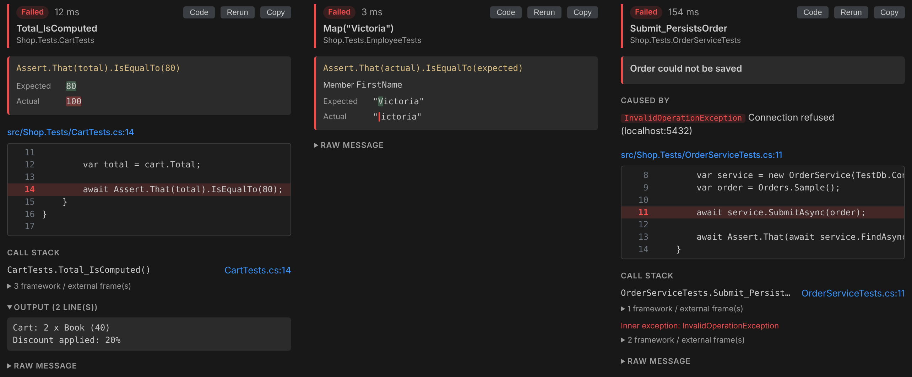

# C# Test Viewer

**Readable .NET test results in VS Code** — built for **TUnit / Microsoft.Testing.Platform**, also works with xUnit, NUnit and MSTest.

Test Explorer shows you *that* a test failed. C# Test Viewer shows you *why*, at a glance: what was expected, what came out, where, and through which calls.

*[Version française](README.fr.md)*

## Features

### Failures you can read

- **Assertion card**: the assertion expression (`Assert.That(total).IsEqualTo(80)`), then **Expected / Actual** with differences highlighted — character diff for strings (including a marker for a *missing* character), line diff for multi-line values, whole-value highlight for numbers.
- **Object comparisons**: the mismatching member is shown on its own (`Member FirstName`).
- **`Assert.Multiple`**: one numbered card per failed assertion.
- **Caused by**: the inner exception chain, each with its type.
- **Code excerpt** around the failing line, highlighted and clickable.
- **Clean call stack**: your code first; async state machines and lambdas simplified, duplicates merged; framework frames folded.
- **Inline in the editor**: `✖ expected 80 · got 100` at the end of the assertion line, full message on hover.
- **Copy** button: test name + message + stack trace, ready for an issue or a chat.

Recognized formats: TUnit, xUnit, NUnit, MSTest, FluentAssertions-style messages. Anything else is shown as is, with the raw message always one click away.

### A test tree that stays out of the way

- **Project › Class › Method › Case** (Theory / Arguments / TestCase / DataRow cases grouped under their method).
- Status, **real elapsed time** (parallel-aware: not the sum of test durations), one-line failure summary on failed tests.
- Run everything, a project, a class, a method, or **only the failures**. Filter by name, or show failures only.
- Run summary: counts, failures with their one-line reason, the 5 slowest tests.

### Fast runs

1. **One build, only when needed**: skipped entirely when nothing changed since the last successful build; `--no-restore` unless a project file changed. The reason for each build is logged (`reason: src/Foo.cs changed`).
2. **Direct launch** of Microsoft.Testing.Platform test apps — no `dotnet run`/MSBuild per run. `launchSettings.json` environment variables are applied like `dotnet run` does.
3. **Projects in parallel.**

Each run logs its timing in the *C# Tests* output (`⏱ build skipped (no changes) · tests 1.28 s — total 1.31 s`).

## Requirements

- .NET SDK 8 or later on the `PATH` (or set `csTestViewer.dotnetPath`).
- **Microsoft.Testing.Platform projects** (TUnit, xUnit v3, MSTest/NUnit runners): the TRX report extension. It ships with the `TUnit` meta-package; with `TUnit.Engine` alone, add `Microsoft.Testing.Extensions.TrxReport`.
- Works side by side with C# Dev Kit.

## How tests are run

| Project | Run |
|---|---|
| TUnit, or `UseMicrosoftTestingPlatformRunner` / `EnableMSTestRunner` / `EnableNUnitRunner` / `TestingPlatformDotnetTestSupport` | test binary launched directly with `--report-trx` |
| Others (VSTest) | `dotnet test --no-build --logger trx` |

Filters: `--treenode-filter` (TUnit), `--filter-class` / `--filter-method` (xUnit v3), `--filter` (MSTest, NUnit, VSTest).
Projects are detected from the `.csproj` and parent `Directory.Build.props` / `Directory.Packages.props`.

## Settings

| Setting | Default | Description |
|---|---|---|
| `csTestViewer.build` | `auto` | `auto` (only if something changed), `always`, `never` |
| `csTestViewer.configuration` | `Debug` | Build configuration |
| `csTestViewer.buildArgs` | `[]` | Extra `dotnet build` arguments |
| `csTestViewer.parallelProjects` | `true` | Run test projects in parallel (disable if they share a database, a port…) |
| `csTestViewer.runner` | `auto` | `auto`, `vstest` or `mtp` |
| `csTestViewer.mtp.extraArgs` | `[]` | Arguments passed to Microsoft.Testing.Platform test apps |
| `csTestViewer.targetFramework` | `""` | Target framework for multi-targeted projects (default: first one) |
| `csTestViewer.extraArgs` | `[]` | VSTest: extra `dotnet test --no-build` arguments |
| `csTestViewer.inlineErrors` | `true` | Failure summary at the end of the assertion line |
| `csTestViewer.revealFailures` | `true` | Expand failed tests after a run |
| `csTestViewer.dotnetPath` | `dotnet` | dotnet executable |
| `csTestViewer.projectExclude` | `**/{bin,obj,node_modules,.git}/**` | Excluded when looking for test projects |

## Known limitations

- **No discovery before the first run**: tests appear once their project has run.
- **No debugging** of tests (use C# Dev Kit for that).
- **TUnit, rerunning failures across several classes**: `--treenode-filter` accepts a single path, so classes and methods are combined — a few extra tests may run, never fewer.
- **Build skipping** relies on VS Code's file watcher. The first run of a session always builds. A test writing files in the workspace (outside `bin`/`obj`/`TestResults`) triggers a build on the next run; the log says which file.
- Requires a **trusted workspace** (it runs `dotnet build` and your test binaries).

## Privacy

No telemetry. The extension only runs `dotnet` and your test binaries locally.

## Feedback

Bugs and ideas: [GitHub issues](https://github.com/jstrullu/csharp-test-viewer/issues).

## License

[MIT](LICENSE)
