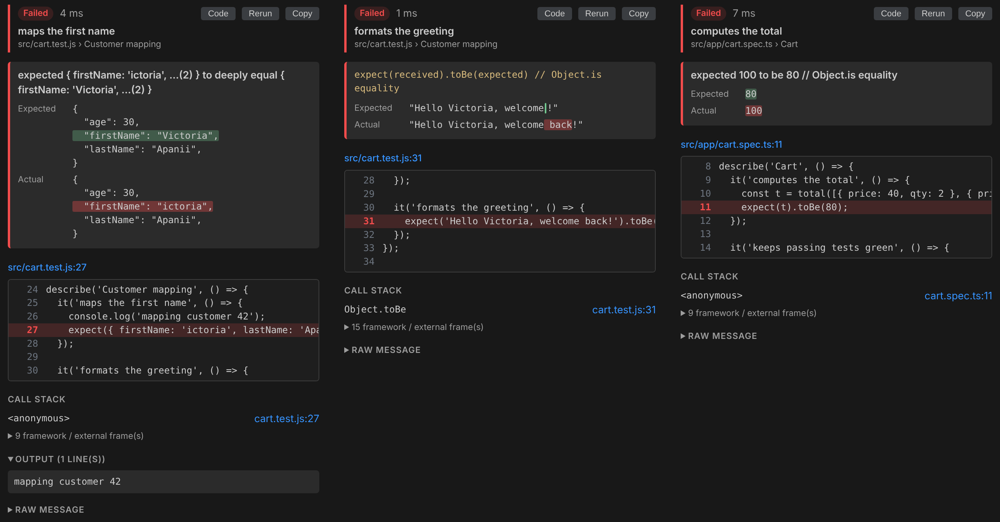
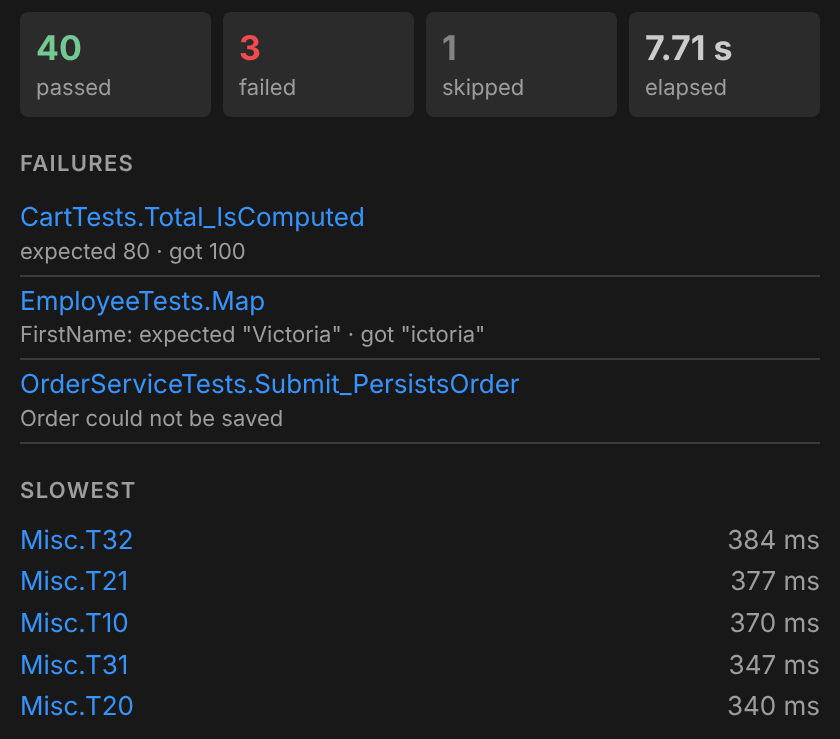

# Readable Tests

<!-- Open VSX : à réactiver quand le namespace jstrullu sera vérifié (l'extension y est inactive d'ici là)

-->

**Readable test results in VS Code, for .NET and JavaScript** — TUnit / Microsoft.Testing.Platform, xUnit, NUnit, MSTest, **Vitest, Jest and the Angular CLI**.

Test Explorer shows you *that* a test failed. Readable Tests shows you *why*, at a glance: what was expected, what came out, where, and through which calls — with the same view whatever the stack.

*[Version française](README.fr.md)*

## Features

### Failures you can read

- **Assertion card**: the assertion (`Assert.That(total).IsEqualTo(80)`, `expect(received).toBe(expected)`), then **Expected / Actual** with differences highlighted — character diff for strings (including a marker for a *missing* character), line diff for objects and multi-line values, whole-value highlight for numbers.
- **Object comparisons**: the mismatching member is shown on its own (.NET), or the differing lines of the object (JavaScript).
- **`Assert.Multiple`**: one numbered card per failed assertion.
- **Caused by**: the inner exception / `Error.cause` chain, each with its type.
- **Code excerpt** around the failing line, highlighted and clickable.
- **Clean call stack**: your code first; async state machines and lambdas simplified, duplicates merged; framework frames and `node_modules` folded.
- **Files that fail to load** (missing import, compile error) appear as a failed entry instead of silently disappearing.
- **Inline in the editor**: `✖ expected 80 · got 100` at the end of the assertion line, full message on hover.
- **Copy** button: test name + message + stack trace, ready for an issue or a chat.

### A test tree that stays out of the way

- .NET: **Project › Class › Method › Case**. JavaScript: **Project › describe (file) › test**.
- Status, **real elapsed time** (parallel-aware: not the sum of test durations), one-line failure summary on failed tests.
- Run everything, a project, a class / `describe`, a single test, or **only the failures**. Filter by name, or show failures only.
- Run summary: counts, failures with their one-line reason, the 5 slowest tests.

### Fast runs

- **.NET**: one build only when needed (skipped when nothing changed; `--no-restore` unless a project file changed; the reason for each build is logged), direct launch of Microsoft.Testing.Platform test apps, `launchSettings.json` environment variables applied.
- **JavaScript**: local Vitest / Jest / Angular CLI launched with `node` (no shell), only the selected files and tests.
- **Projects in parallel**, .NET and JavaScript alike.

Each run logs its timing in the *Readable Tests* output (`⏱ build skipped (no changes) · tests 1.28 s — total 1.31 s`).

## Requirements

- **.NET**: SDK 8 or later on the `PATH` (or `readableTests.dotnetPath`). For Microsoft.Testing.Platform projects (TUnit, xUnit v3 with `UseMicrosoftTestingPlatformRunner`, MSTest/NUnit runners), the TRX report extension — included in the `TUnit` meta-package; with `TUnit.Engine` alone, add `Microsoft.Testing.Extensions.TrxReport`.
- **JavaScript**: Node.js on the `PATH` (or `readableTests.nodePath`) and dependencies installed (`npm install`) — the extension uses the project's own Vitest, Jest or Angular CLI.
- Works side by side with C# Dev Kit and the Vitest / Jest extensions.

## How tests are run

| Project | Detected from | Run |
|---|---|---|
| TUnit, or `UseMicrosoftTestingPlatformRunner` / `EnableMSTestRunner` / `EnableNUnitRunner` / `TestingPlatformDotnetTestSupport` | `.csproj` (+ parent `Directory.Build.props`) | test binary launched directly with `--report-trx` |
| xUnit v3 without `UseMicrosoftTestingPlatformRunner` | `.csproj` (+ parent `Directory.Build.props`) | test binary launched directly with its native command line (`-result-trx`) |
| xUnit v2, NUnit, MSTest (VSTest) | `.csproj` | `dotnet test --no-build --logger trx` |
| Angular CLI (Vitest) | `angular.json`, test target using `@angular/build:unit-test` | `ng test <project> --no-watch` |
| Vitest | `vitest` dependency + `vitest.config.*` / `vite.config.*` or a `vitest` test script | `vitest run` |
| Jest | `jest` dependency + `jest.config.*`, a `jest` key in `package.json` or a `jest` test script | `jest --ci` |

JavaScript results come from a small reporter shipped with the extension (Vitest 1–5, Jest 27+), which gives exact expected/actual values, stack traces, test locations and console output.

Filters: `--treenode-filter` (TUnit), `--filter-class` / `--filter-method` (xUnit v3 on MTP), `-class` / `-method` (xUnit v3 native), `--filter` (MSTest, NUnit, VSTest), test files + `-t` / `--filter` name pattern (Vitest, Jest, Angular CLI).

## Settings

| Setting | Default | Description |
|---|---|---|
| `readableTests.build` | `auto` | .NET: `auto` (only if something changed), `always`, `never` |
| `readableTests.configuration` | `Debug` | .NET build configuration |
| `readableTests.buildArgs` | `[]` | Extra `dotnet build` arguments |
| `readableTests.parallelProjects` | `true` | Run test projects in parallel (disable if they share a database, a port…) |
| `readableTests.runner` | `auto` | .NET: `auto`, `vstest`, `mtp` or `xunit3` |
| `readableTests.mtp.extraArgs` | `[]` | Arguments passed to Microsoft.Testing.Platform test apps |
| `readableTests.xunit3.extraArgs` | `[]` | Arguments passed to xUnit v3 test apps (native command line) |
| `readableTests.targetFramework` | `""` | Target framework for multi-targeted projects (default: first one) |
| `readableTests.extraArgs` | `[]` | VSTest: extra `dotnet test --no-build` arguments |
| `readableTests.nodePath` | `node` | Node.js executable for Vitest, Jest and the Angular CLI |
| `readableTests.vitest.extraArgs` | `[]` | Extra `vitest run` arguments |
| `readableTests.jest.extraArgs` | `[]` | Extra `jest` arguments |
| `readableTests.angular.extraArgs` | `[]` | Extra `ng test` arguments (e.g. `["--browsers=chromiumHeadless"]`) |
| `readableTests.inlineErrors` | `true` | Failure summary at the end of the assertion line |
| `readableTests.revealFailures` | `true` | Expand failed tests after a run |
| `readableTests.dotnetPath` | `dotnet` | dotnet executable |
| `readableTests.projectExclude` | `**/{bin,obj,node_modules,.git,wwwroot,bower_components,dist}/**` | Excluded when looking for test projects (`wwwroot` / `dist` hold copied libraries, not test projects) |

## Known limitations

- **No discovery before the first run**: tests appear once their project has run.
- **No debugging** of tests (use C# Dev Kit or the Vitest / Jest extensions for that).
- **Angular**: only the `@angular/build:unit-test` builder (Vitest, the default for new projects). Karma is not supported. `ng test` compiles the project on every run (a few seconds).
- **Jest**: console output is not attached to individual tests (Jest reports it per file).
- **Vitest < 4**: no test location for passing tests — "Go to code" searches the test title in the file.
- **Yarn Plug'n'Play** (no `node_modules`) is not supported.
- **TUnit, rerunning failures across several classes**: `--treenode-filter` accepts a single path, so classes and methods are combined — a few extra tests may run, never fewer.
- **.NET build skipping** relies on VS Code's file watcher; front-end files (`.ts`, `.js`, `.html`, `.css`…) never trigger a .NET build. The first run of a session always builds.
- Requires a **trusted workspace** (it runs your build and test tools).

## Privacy

No telemetry. The extension only runs `dotnet`, `node` and your test tools locally.

## Feedback

Bugs and ideas: [GitHub issues](https://github.com/jstrullu/readable-tests/issues/new/choose). Security issues: see [SECURITY.md](SECURITY.md).

## License

[MIT](LICENSE)
